# Sealstone

### The Adversarial Milestone Escrow Protocol
**Escrow that cannot be tricked by ambiguous agreements, swapped deliverables, or malicious smart contracts.**

Built for **VORTEXA 3.0** · Problem **B-03 · MilestoneVault: Adversarial Smart-Contract Escrow** · Team Torvalds.

---

<p align="center">
  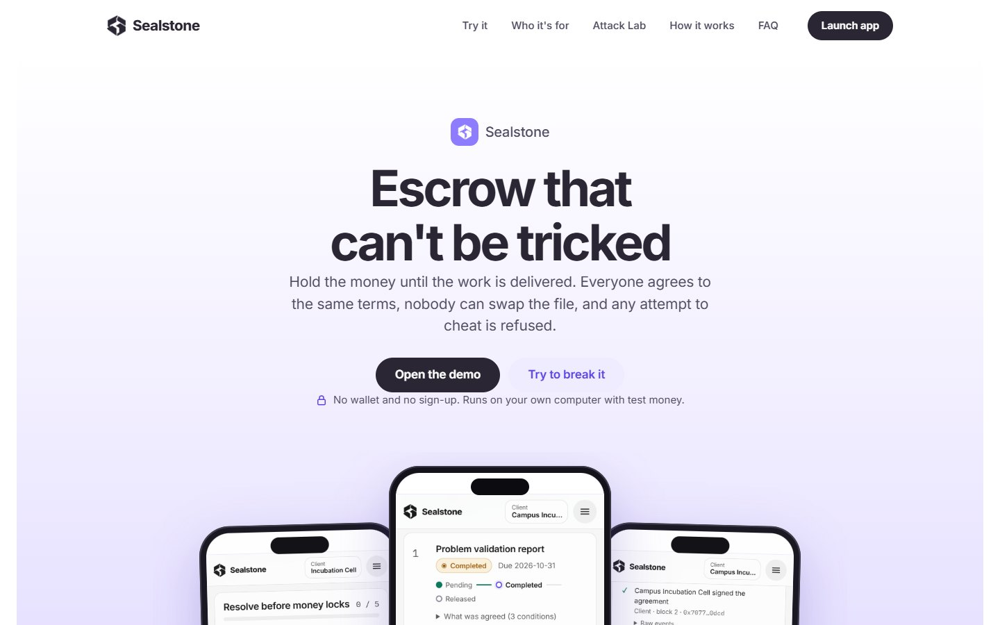
</p>

<p align="center">
  <a href="https://testnet.mstscan.com/tx/0x19182aa6e8913073ef8bbd26c2be4e95d57bb411fb1cfce5a38af8c02b2e0e2a"></a>
  
  
  
  
  
</p>

---

## 🌐 Public Blockchain Deployment Proof (MST Testnet)

Sealstone is verified and deployed on the **MST Blockchain Testnet**. You can independently verify the contract deployment transaction on the official block explorer:

| Parameter | Value / Link |
|---|---|
| **Network** | **MST Testnet** (Chain ID: `91562037` / `0x5752035`) |
| **Deployment Tx** | [`0x19182aa6e8913073ef8bbd26c2be4e95d57bb411fb1cfce5a38af8c02b2e0e2a`](https://testnet.mstscan.com/tx/0x19182aa6e8913073ef8bbd26c2be4e95d57bb411fb1cfce5a38af8c02b2e0e2a) |
| **Explorer** | [https://testnet.mstscan.com](https://testnet.mstscan.com) |
| **RPC Endpoint** | `https://testnetrpc.mstblockchain.com` |
| **Native Token** | `tMSTC` ([Faucet Available](https://faucet.mstblockchain.com/)) |
| **Contract State** | Initialized with dual-signed `agreementHash`, zero external dependencies, 100% self-contained |

> **Live Explorer Proof:** Click the deployment transaction link above to view the confirmed contract creation, gas metrics, and cryptographic event logs directly on MSTScan.

---

## Executive Summary

Billions of dollars move through milestone-based commercial agreements: enterprise grants, software contracting, construction disbursements, and freelance work. In traditional escrow, trust is outsourced to centralized intermediaries with opaque fees and discretionary adjudication.

Naive smart contracts solve the intermediary problem, but **code that controls money is unforgiving**. Real-world escrow collapses at three distinct failure points:

1. **The Agreement Problem (Ambiguity)**: Terms drafted in prose contain loopholes (*"to client satisfaction"*, *"paid from remaining funds"*). A contract filled with ambiguous terms is simply a lawsuit waiting to happen.
2. **The Deliverable Problem (Substitution)**: "Approved" in Web3 simply means a client signed a transaction. It rarely binds the approval to the *exact file reviewed*. Providers can swap deliverables after the fact.
3. **The Execution Problem (Vulnerabilities)**: Flawed state machines, re-entrancy bugs, force-sent ETH accounting errors, and front-running drain contracts before books can update.

### The Sealstone Architecture: Three Cryptographic Seals
Sealstone is the first escrow protocol built with **three interlocking integrity layers**:

```
 ╔═════════════════════════════════════════════════════════════════════════════════════════════════╗
 ║ 1. TERMS SEAL     AI extracts ─▶ Deterministic rules gate ─▶ Human resolves all flags ─▶        ║
 ║                   keccak256(canonical JSON) stored on-chain. Both parties co-sign the hash      ║
 ║                   before a single wei can be deposited.                                         ║
 ╠═════════════════════════════════════════════════════════════════════════════════════════════════╣
 ║ 2. WORK SEAL      Provider commits SHA-256(file) on-chain ─▶ Client must submit the matching   ║
 ║                   file to approve. Tampered or swapped deliverables revert automatically.       ║
 ╠═════════════════════════════════════════════════════════════════════════════════════════════════╣
 ║ 3. MONEY SEAL     Strict finite state machine · Pull payments (CEI) · Reentrancy guard ·        ║
 ║                   Real-time accounting reconciliation · Live interactive Attack Lab             ║
 ╚═════════════════════════════════════════════════════════════════════════════════════════════════╝
```

> **The Invariant Rule:** *AI proposes, a human decides, and the smart contract enforces.* AI output is never written directly to the blockchain.

---

## 📊 Frameworks & Flowcharts

### 1. Protocol Lifecycle Framework (End-to-End)

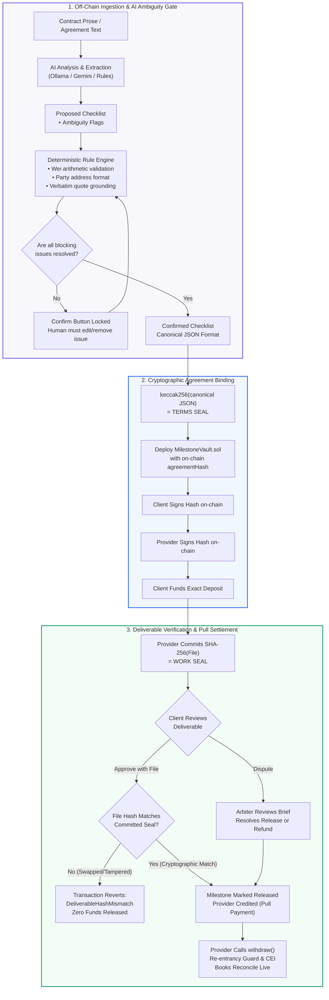

---

### 2. Milestone Finite State Machine

Every milestone strictly follows an immutable, mathematically verified state machine. Any transition not documented below reverts with an explicit custom error and preserves contract storage unchanged:

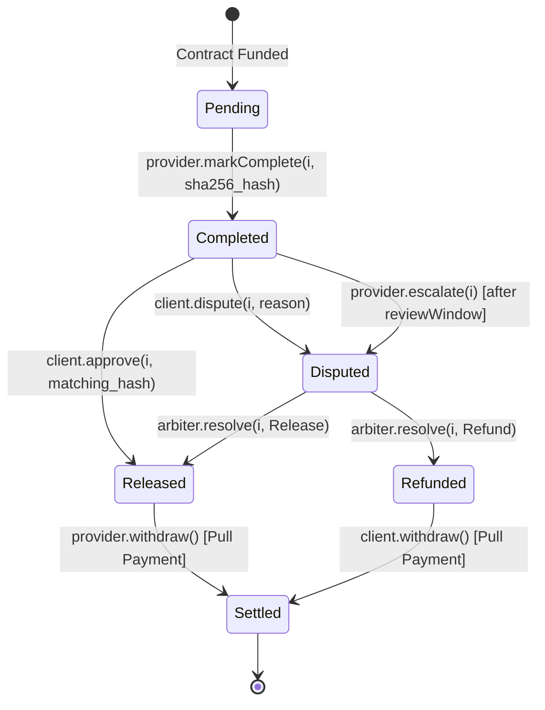

---

### 3. System Architecture & Zero-Trust Boundary Topology

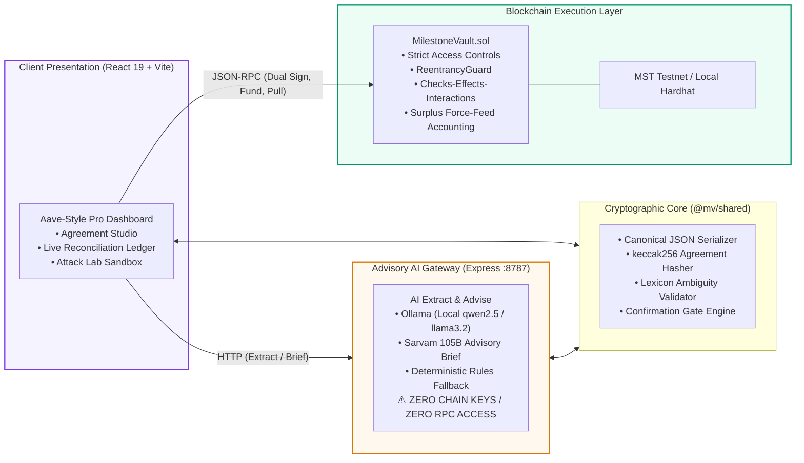

---

## 📸 Product Walkthrough (Real App Screenshots)

Every screenshot below is captured from the live Sealstone web application running against our smart contracts:

### 1. Agreement Studio & AI Ambiguity Detection
Paste raw commercial prose. Sealstone parses milestones, amounts, parties, and deadlines, highlighting problematic clauses. The **Confirm** button remains strictly locked until every blocking ambiguity is resolved.

<p align="center">
  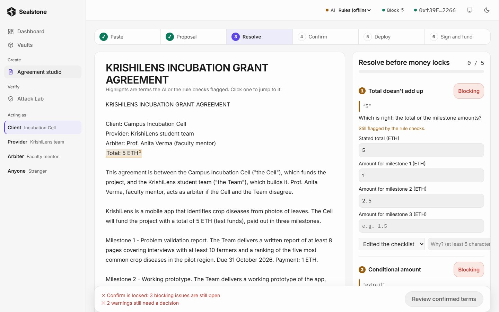
</p>

---

### 2. Terms Seal Cryptographic Generation
After resolving all clauses, Sealstone turns the checklist into canonical JSON and hashes it with keccak256. This immutable hash is stored on-chain; both client and provider must sign it before funding.

<p align="center">
  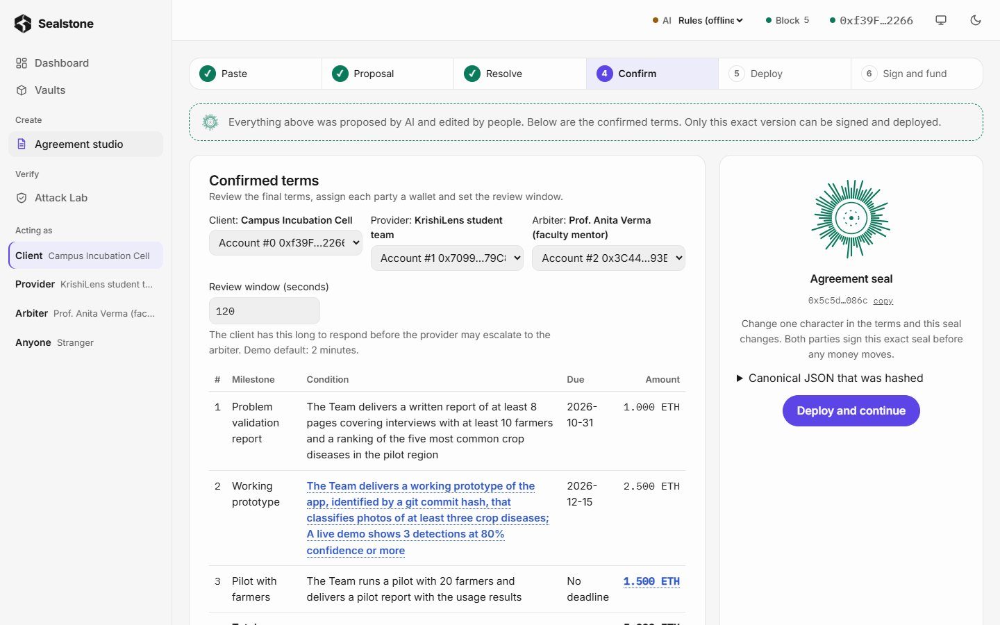
</p>

---

### 3. Institutional Dashboard & Live Ledger
View locked escrow, pending milestones, active dispute windows, and automated accounting reconciliation. The balance strip verifies that `Deposited == Escrow Held + Released + Refunded`.

<p align="center">
  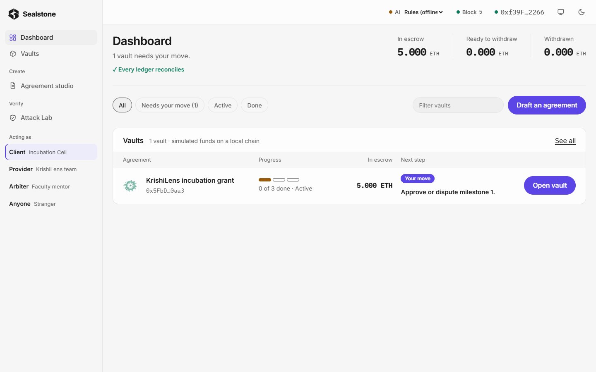
</p>

---

### 4. Vault Lifecycle & Milestone Execution
Each milestone shows real-time role-based action buttons. The contract enforces distinct step sequences: only the provider can submit, only the client can approve, and only the arbiter can resolve disputes.

<p align="center">
  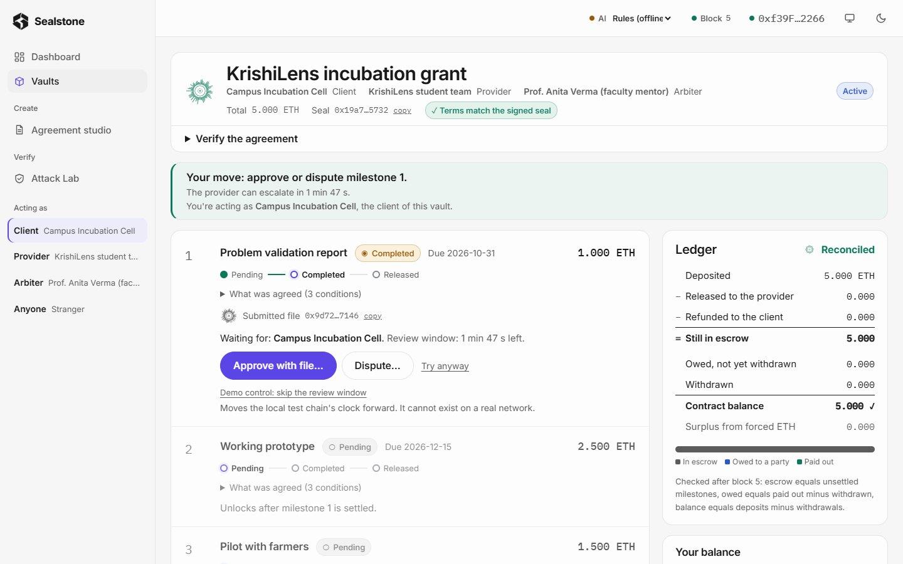
</p>

---

### 5. Work Seal: Tampered Deliverable Protection
When approving, the client presents the file reviewed. If an attacker attempts to release funds with a modified or look-alike file (e.g. `m1-report-v2.pdf`), the hashes mismatch visually and on-chain.

<p align="center">
  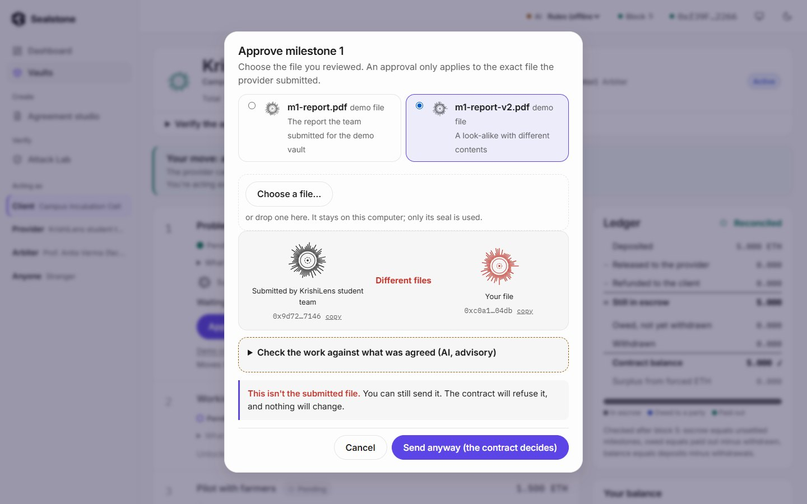
</p>

The contract transaction reverts with `DeliverableHashMismatch`. Not a single wei moves.

<p align="center">
  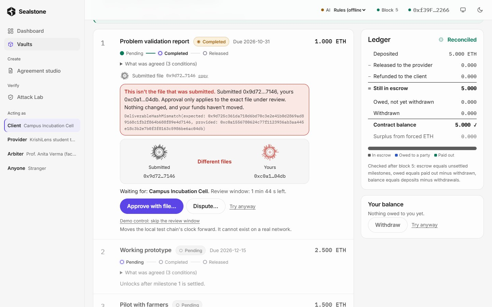
</p>

---

### 6. The Attack Lab: Live Adversarial Assault & Naive Contrast
The Attack Lab fires **12 live exploit transactions** at sandbox vaults. It runs the identical reentrancy drain against a standard naive escrow versus Sealstone, visually showing the contrast:

<p align="center">
  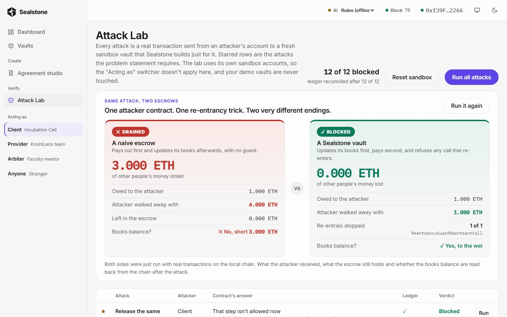
</p>

*Result: Naive escrow is drained of 3.000 ETH of other users' money. Sealstone blocks the attack with 0 ETH lost and books 100% reconciled.*

---

### 7. Advisory AI & Arbiter Evidence Brief
When a dispute occurs, arbiters receive a structured evidence brief with verbatim quoted clauses from both parties. The AI is strictly advisory: only human arbiters can trigger resolution buttons.

<p align="center">
  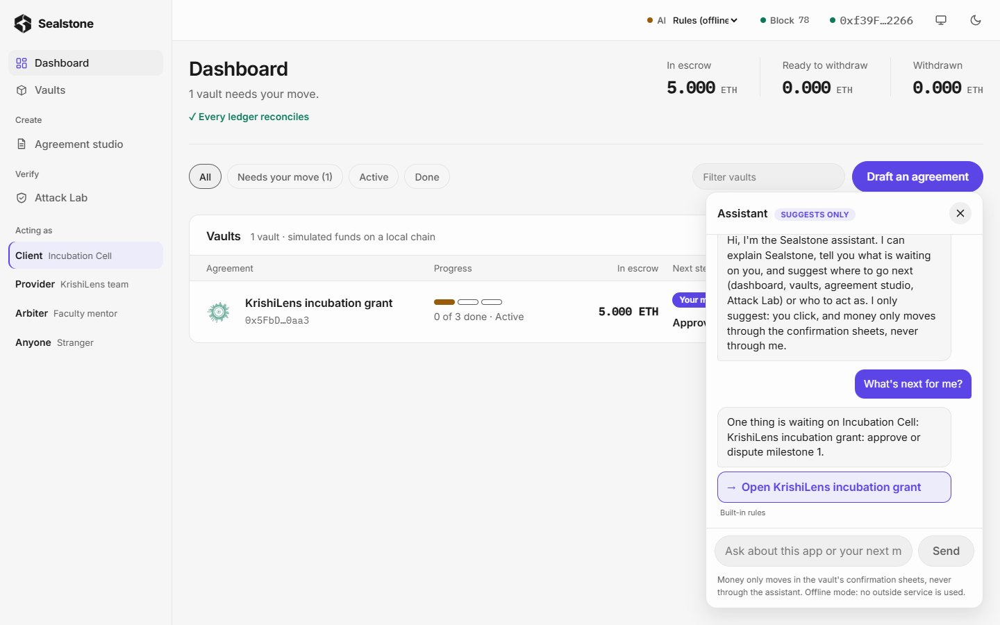
  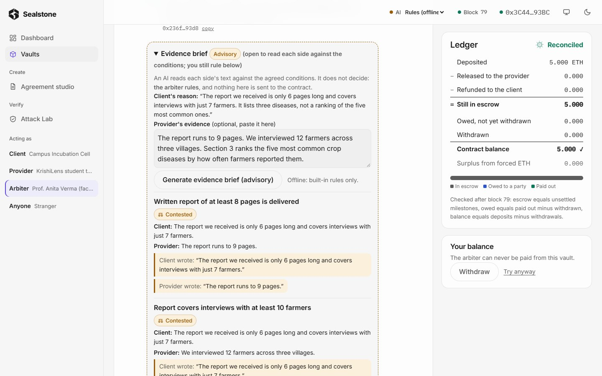
</p>

---

## ⚔️ The Attack Lab: 12 Real Attack Vectors Blocked

| # | Attack Scenario | Threat Vector | Contract Response | Proof in Tests |
|---|---|---|---|---|
| 1 | **Double Release** | Provider/Client attempts to release milestone twice | `InvalidMilestoneState` | `rejects a second release attempt` |
| 2 | **Unauthorized Refund** | Client or stranger attempts to seize escrowed deposit | `NotArbiter` | `rejects an unauthorized refund` |
| 3 | **Out-of-Order Transition** | Client approves unsubmitted work or skips milestone | `InvalidMilestoneState` | `rejects an out-of-order transition` |
| 4 | **Reentrancy Exploit** | Malicious contract re-enters `withdraw()` recursively | Blocked by `ReentrancyGuard` | `blocks a re-entrancy attack` |
| 5 | **Tampered Deliverable** | Approval submitted with modified document hash | `DeliverableHashMismatch` | `rejects approval of a swapped deliverable` |
| 6 | **Self-Approval** | Provider tries to approve their own work | `NotClient` | `access-control table test` |
| 7 | **Premature Ruling** | Arbiter attempts to rule on undisputed milestone | `InvalidMilestoneState` | `state-machine table test` |
| 8 | **Deposit Mismatch** | Client attempts to fund less or more than agreed total | `WrongFundingAmount` | `rejects wrong funding amounts` |
| 9 | **Direct Transfer** | Attacker transfers raw ETH directly to contract | `DirectPaymentNotAccepted` | `rejects direct ETH transfers` |
| 10 | **Forced ETH Inflow** | Attacker forces ETH via `selfdestruct` | Absorbed as surplus, books balance | `keeps books reconciled and surplus visible` |
| 11 | **Premature Escalation** | Provider escalates before review window expires | `ReviewWindowOpen` | `rejects early escalation` |
| 12 | **Zero-Credit Drain** | Stranger attempts to call `withdraw()` with zero balance | `NothingToWithdraw` | `rejects withdraw with no credit` |

---

## 🏆 Competitive Differentiation Matrix

| Capability | Traditional Escrow (Upwork, Escrow.com) | Standard Web3 Escrow | Sealstone Protocol |
|---|:---:|:---:|:---:|
| **Cryptographic Terms Verification** | ❌ None (prose only) | ❌ Raw parameters only | ✅ **keccak256 canonical agreement seal** |
| **Tampered Deliverable Protection** | ❌ Manual dispute | ❌ None (binary approval) | ✅ **SHA-256 deliverable-bound approval** |
| **Adversarial Resilience** | N/A (centralized ledger) | ⚠️ Common reentrancy / CEI bugs | ✅ **12/12 attacks blocked, 100% covered** |
| **Reentrancy Protection** | N/A | ⚠️ Often push-payment vulnerable | ✅ **Checks-Effects-Interactions + Pull Payments** |
| **Accounting Invariance** | ❌ Opaque bank ledger | ⚠️ Balance can desync on force-send | ✅ **On-chain reconciliation with surplus isolation** |
| **AI Role & Safety** | ❌ None | ⚠️ High risk (AI triggers transactions) | ✅ **Advisory-only gate; zero chain privileges** |
| **Public Chain Deployment** | ❌ None | ⚠️ Testnet or local only | ✅ **MST Testnet Verified (`0x19182aa6...`)** |
| **Offline Independence** | ❌ None | ❌ Cloud / Infura reliant | ✅ **100% self-contained local fallback** |

---

## 🚀 Quick Start Guide

Sealstone requires **Node.js 20+** and **Git**. It is completely self-contained with zero paid dependencies and runs fully offline:

```bash
# 1. Clone the repository
git clone https://github.com/Hackmaass/SealStone.git
cd SealStone

# 2. Install all workspace dependencies
npm run setup

# 3. Launch the complete local stack (Chain, AI API, Web App)
npm run dev
```

Open **`http://localhost:5173`** in your browser. The app connects to the local blockchain node automatically with seeded demo accounts, ready for you to test.

### Helpful Commands

```bash
npm run test:contracts   # Run the 138 Hardhat contract tests
npm run coverage         # Run Solidity code coverage (100% line coverage)
npm run test:shared      # Run shared package tests (hashing, validator, gate)
npm run demo:reset       # Reset chain state and redeploy the demo vault
```

---

## 📜 Team & Hackathon Submission

- **Hackathon**: VORTEXA 3.0 (12-Hour National Hackathon)
- **Track**: Blockchain (Problem B-03 · MilestoneVault)
- **Team**: Team Torvalds (Team ID: `XQR1520246`)
- **Members**: Omkar Rane (Lead Builder), Pranay Patil (Research & Scenarios)
- **Repository**: [https://github.com/Hackmaass/SealStone](https://github.com/Hackmaass/SealStone)
- **Public Explorer Proof**: [MST Testnet Deployment Transaction](https://testnet.mstscan.com/tx/0x19182aa6e8913073ef8bbd26c2be4e95d57bb411fb1cfce5a38af8c02b2e0e2a)
